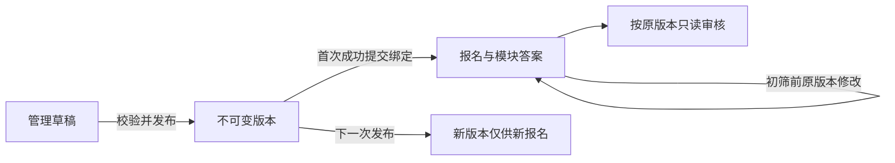

# 导航整合与模块化报名表技术设计

日期：2026-10-15。状态：用户于 2026-10-15 批准实施；第一、二批已完成；动态提交/附件与三端界面后续两批待施工。需求以 `docs/navigation-recruitment-requirements-20261015.md` 为准；上游固定版本与差异见 `docs/openlims-diff-20261015.md`。

## 1. 增量适配策略

以 YES Lab 当前源码为主，参考上游新增能力。新 Java 代码使用 `cn.yeslab.platform`，保留 `yeslab` 浏览器存储键、现有鉴权封装、品牌与上传目录。只合并相关差异；不覆盖整套前端或后端。

任务业务服务不作规则改造。报名表写入需提取原 `RecruitmentService` 中必要的建档、基础资料规范化和首次状态历史逻辑，避免将面试/转正/任务发行复制到新服务。旧固定 DTO 和技术题校验继续负责 legacy；动态路径以服务器 schema 校验，不用空白假答案绕过旧注解。

## 2. 导航与页面组织

- 局部修改 PortalShell 的入口数组，Logo 保持 `/`；管理员链接直接 `/admin`。已有 ResizeObserver 宽度算法继续使用，计算包含账号区、间距和必要的“更多”宽度；字体加载、角色/文字变化时复测，全部可容纳则无菜单按钮。
- 提取 `ProfileTodayPanel` 或等价组件，合入 ProfileView；每种数据由明确的一个加载入口负责，日程/积分只渲染一份。保留局部加载失败、重试、资料、密码和成员补资料守卫。
- `/today` 保留兼容重定向，query/hash 不丢失；更新登录默认落点、命令面板、公开页账号链接、补资料后默认返回。`/profile/edit` 不变。
- 新增公开 `GET /api/v1/public/member-profiles/{profileId}/points`：先调用现有公开档案资格检查，再聚合积分。独立 DTO 仅 `totalPoints/serverDate/dailyPoints[{date,points}]`，不返回本人 summary 的流水和分类明细。沿用实验室时区和本人热力图日期范围，切换公开成员时取消/忽略旧请求并清理旧状态。
- 建立 AdminTaskManagementView，分类写入 `/admin/tasks?type=standard|onboarding|bounty`；非法/缺省 type 回普通。保留其他有意义 query/hash，不增加重复页头。三类视图只提取内容，不合并业务状态。
- `/admin/tasks/onboarding`、`/admin/bounties` 跳到对应分类；进度/子任务/名单/履约原地址保留，返回正确分类，侧栏和面包屑归属任务管理。
- 分类切换是 query 变化，必须同时处理 `onBeforeRouteUpdate` 与离开守卫；验证浏览器前进/后退和撤销切换。抽屉及表单脏状态统一向容器注册，拒绝后 URL 和内容保持原分类。

## 3. 配置与数据库

参考 OpenLIMS 第一批受控 schema：`schemaVersion/title/description/modules`；模块使用稳定 UUID、type、title、description、required、enabled、displayOrder、binding 与类型配置。类型 BASIC_INFO/CHOICE/TEXT/UPLOAD/TECHNICAL/INFO；字段与选项同样有稳定 ID。排序不改 ID，复制生成新 ID，ID 与系统 binding 不允许重复。

| 结构                          | 保存内容/约束                                                                                  |
| ----------------------------- | ---------------------------------------------------------------------------------------------- |
| recruitment_form_config       | 固定 id=1；草稿 JSON、draftRevision、publishedDraftRevision、当前版本指针、操作者/时间、乐观锁 |
| recruitment_form_versions     | 不可变 schema LONGTEXT、唯一版本号、发布人/时间；没有修改/删除历史版本接口                     |
| recruitment_applications 新列 | form_version_id 可空、form_answers_json 可空、form_answers_revision 默认 0                     |
| recruitment_form_attachments  | 报名、账号、moduleId、随机存储名、原名、MIME、字节数、顺序、active、创建时间                   |
| recruitment_form_submissions  | 账号+requestKey 唯一；请求指纹、报名/版本、结果 JSON、时间，用于安全重试                       |

候选新增迁移 V23：当前仓库最高 V22，最后引入提交 `fe925ed`；施工前再查全部编号、git log 与生产 `flyway_schema_history`，冲突则用下一个新编号。不修改任何既有迁移，不 repair。参考上游 MySQL 脚本并适配本项目，缺表/列/约束才新增；检测同名结构不兼容时停止而非默认成功。

JSON 采用 LONGTEXT，应用对结构、UTF-8 字节数和业务长度校验。初始化器与演示账号初始化分离，事务生成默认版本与单例配置；并发启动唯一约束竞争回滚后确认实际配置存在，不吞其他数据库异常。旧报名版本为 NULL，保留原技术答案、图片与阶段，不回填或重写。

## 4. API 契约

全部沿用现有 ApiResponse、JWT Authorization 头和权限校验。配置错误保留原错误响应并增加可选 fields；旧构造默认空 fields。以下 `/api/v1` 前缀省略。

| 方法/路径                                                                     | 权限/用途                                                                                        |
| ----------------------------------------------------------------------------- | ------------------------------------------------------------------------------------------------ |
| GET /admin/recruitment/form                                                   | RECRUITMENT_MANAGE；草稿、revision、当前发布、是否有未发布变更                                   |
| PUT /admin/recruitment/form/draft                                             | 同上；`{expectedRevision,schema}`，缺 revision 拒绝，过期 409                                    |
| POST /admin/recruitment/form/publish                                          | 同上；`{expectedRevision}`；同草稿重复发布不增版本                                               |
| GET /admin/recruitment/form/versions/{versionId}                              | 同上；历史不可变快照                                                                             |
| GET /recruitment/me/form                                                      | RECRUITMENT_SELF_VIEW；legacy 标记或本人应使用的版本，附动态答案/revision/附件和服务器分配技术题 |
| PUT /recruitment/me/modular                                                   | RECRUITMENT_SELF_EDIT；multipart 原子提交，按本人账号写入                                        |
| GET /admin/recruitment/applications/{applicationId}/form                      | RECRUITMENT_MANAGE；绑定版本、动态答案、技术题快照、附件，或 legacy 标记                         |
| GET /recruitment/applications/{applicationId}/form-attachments/{attachmentId} | 本人或 RECRUITMENT_MANAGE；核对附件归属后鉴权下载                                                |

管理配置协议可复用上游；申请者读取扩展只增加字段，不公开管理员发布人信息。不存在/无权限/阶段锁定/过期 revision 等按项目现有响应约定返回；错误 fields 使用稳定模块/字段 ID，配置编辑错误可额外携带 schema 数组路径。

动态提交 JSON part 命名 payload：`{formVersionId,expectedAnswersRevision,requestKey,answers,newFiles}`；首次 revision=0。answers 按 moduleId 索引：基础信息按 fieldId，选择为 optionId 数组，文字为对应格式值，上传为已有 attachmentId 有序数组，技术题为服务器 questionId 对应答案，INFO 不收答案。newFiles 为 `{fileKey,moduleId,displayOrder}` 清单，每个文件使用 `file.<fileKey>` part；key 唯一，拒绝未声明 part/重复引用/跨模块附件。

答案与清单有独立请求大小上限（建议答案 JSON 256KiB、清单 20 项），禁止任意 HTML/脚本、未知/停用模块和未知字段。提交指纹规范化版本、revision、答案、排序、文件字节摘要及必要展示元数据，不依赖 multipart 顺序。同 key 同内容返回原提交结果；同 key 不同内容返回冲突。

原 GET/PUT `/recruitment/me`、作品图片接口保留。legacy 报名和旧客户端首次提交继续按旧规则；已有模块化报名通过旧写接口修改时返回 409 并提示使用新表单，防止绕过 schema/revision。现有列表/面试/转正仍读取兼容字段投影；旧图片 GET 不受影响。

## 5. 版本、校验与字段投影

首次提交最终事务锁定全局配置并核对当前版本；读表后发布竞争返回 409，不能接受陈旧版本首次报名。已有报名锁定自身行，检查原版本、revision 和 SIGNUP 阶段；新版不能迁移其版本。阶段变更与正文写入使用同一报名行锁，避免初筛和提交竞争。

并发首次报名按账号串行，并由既有一账号一报名约束兜底。统一锁顺序为账号→配置（仅首次）→报名→提交/附件；阶段操作不反向获取配置锁。幂等已成功结果可在阶段推进后只读重放，不再次写入或重新开放编辑。

技术题沿用当前基于账号稳定打乱题库的 5 题分配；服务器返回题目，提交核对 ID 与至少 3 个不同有效答案，拒绝伪造题目/重复/空白答案。首次成功提交在动态答案中保存服务器生成的题目内容快照，后续读原快照。停用技术模块的新报名不要求技术答案，旧表/原版本仍执行原规则。

基础资料同步 name/email/major/className/grade/phone/wechat；默认模块 binding 同步 interestDirections/existingSkills/intendedTags/selfIntroduction/experience/portfolioIntroduction/mediaLinks。保持现有字段长度、邮箱规范化和 contact 推导，不把自定义字段映射到身份。普通绑定模块停用的新报名写真实空值/空集合，不能填虚构占位；旧报名不受影响。默认作品模块读取新附件，旧作品图片保留旧实体与旧访问接口。

初次加载表单更新时按稳定 ID、类型、选项保存仍兼容输入；不兼容值暂存在本地恢复区并说明原因，用户复核再提交。浏览器草稿按账号和 formVersionId 隔离，退出沿用清理规则；File 不伪装成可恢复的已上传附件，刷新后提示重新选择。

## 6. 附件事务与私有访问

先验证权限、阶段、版本、文本、清单、既有附件归属和数量/大小，再处理新文件。图片检测真实 JPG/PNG/WebP 并限制解码尺寸，PDF 用解析器验证文件结构，不能只检查扩展名、客户端 MIME 或 `%PDF` 前缀。PDF只提供下载；原始文件名规范化用于展示，磁盘路径只由服务端随机名生成并检查边界。

私有文件目录放在现有 recruitment 上传根下的独立子目录，保留旧文件路径。暂存文件属于本次请求，完成写盘后才在同一数据库事务提交报名、答案、附件和首次状态历史；事务回滚清理仅本次新文件。事务同步清理覆盖最终提交失败；进程崩溃遗留暂存文件另做明确审计，不能泛化删除业务目录。删除附件采用 active=false/解除引用，保留业务文件；已移除附件禁止再下载或引用。

最终事务内重新核对阶段、版本和 revision。请求/领域限额同时执行：现有 multipart 20MB/80MB 保持，领域使用 5MiB/10MiB 和全表 20份/50MiB（包括保留附件）；配置必填上传不得组合出超过系统上限的不可提交表单。

下载响应私有/no-store、nosniff；图片鉴权 fetch 后 Blob 预览，卸载/移除撤销 ObjectURL；PDF Content-Disposition=attachment。前端不把 token 放 URL，不生成公共静态链接。本人只能读自己的活动附件，管理员需要真实权限，不以“前端后台可见”替代鉴权。

## 7. 三端界面与设计系统

本次已加载 ui-ux-pro-max，并读取 MASTER 与 pro-rules。查询 `form error validation feedback --domain ux` 命中提交反馈、可聚焦错误摘要、错误恢复；采纳就地错误+摘要链接+提交后聚焦，失败保留输入。`form reactive validation --stack vue` 用作响应式与集中校验参考；不因此自动新增表单库依赖。

沿用现有语义 token、Lucide SVG、SaveBar、Toast、ConfirmDialog 与 useUnsavedGuard。施工时增量维护相关页面覆盖，不覆盖 MASTER 或更改全站视觉。

| 页面/模式            | 内容和交互                                                                                                               |
| -------------------- | ------------------------------------------------------------------------------------------------------------------------ |
| 招新管理：报名表设置 | 现有招新管理内二级视图，不新增一级侧栏。桌面模块列表+配置区，手机上下堆叠；上移/下移及启停/删除有文字按钮，复制产生新 ID |
| 编辑器操作条         | 保存草稿、预览、发布分开；显示草稿未保存/已保存/未发布状态和当前版本；删除/发布确认，失败不关闭编辑内容                  |
| 预览                 | 使用同一模块渲染器，能切换桌面/手机预览；以当前草稿展示，显著标明预览，不提交真实报名、不上传文件                        |
| 申请者               | 原 `/application` 路由；只替换报名正文为动态渲染，保留进度、面试与新手任务；legacy 继续原表。说明上传限制及初筛锁定      |
| 管理员审核           | 保留筛选/阶段/面试等操作；报名正文按原发布顺序只读，显示版本号、题目快照、选择文字和私有附件                             |

共用 `RecruitmentFormRenderer`，模式 fill/preview/read，类型组件只负责各模块呈现；共享客户端校验函数，服务器独立校验。字段稳定 label/input ID、required/aria-describedby、错误摘要链接；只读内容显示完整答案，不把停用或删除后的当前配置误套历史。

编辑器保存成功更新 pristine；保存失败不清除脏状态，发布前先保存并使用返回 revision。已保存但未发布允许退出并提示状态，未保存切换视图/返回需确认。冲突保留本地副本，允许刷新对比后再保存，不提供静默覆盖。

## 8. 真实 MySQL 人工验收步骤

以下为待执行步骤，不声称已完成；H2 关闭 Flyway，不能验证迁移。

1. 在专用预生产 MySQL 8.4 副本备份数据库和完整上传目录；记录 MySQL 版本、引擎、`flyway_schema_history` 版本/校验和、各阶段报名数量、答案字段摘要与作品数量/文件清单。核对 accounts/recruitment_applications 主键 BINARY(16)，历史迁移有差异先停止，禁止 repair。
2. 从已有真实结构副本执行候选 V23，另准备由全部迁移初始化的空库验证；检查四表、三列、外键、版本号、storedName 和账号/requestKey 唯一约束。对结构冲突和权限不足明确报错，不吞异常。
3. 比较迁移前后历史报名/阶段/答案/图片与文件摘要：旧版指针/答案 JSON 为 NULL，revision=0，原数据不变。直接重跑新增 SQL 检验补缺幂等，不能改 Flyway 历史行来模拟重复迁移。
4. 新后端启动及再次启动，确认默认版本/单例配置仅一份；两实例并发初始化无额外版本。旧报名读取仍为 legacy。配置保存不改当前发布，发布不改旧快照。
5. 用 InnoDB 验证同 revision 编辑/发布冲突、同账号并发首次提交、新提交与发布竞争、初筛与编辑竞争、修改 revision 冲突、重复请求不增附件/历史。记录实际响应和数据库行数，不能用 H2 锁测试替代。
6. 验证图片/PDF、跨人/跨模块引用、大小/类型超限、失败回滚、鉴权下载、初筛后修改拒绝；检查新报名核心资料与原流程建档一致，旧图片仍可读。
7. 部署后按部署 SHA 核对新增迁移成功/校验和、四表三列、默认版本、旧/新报名及文件读取。回退应用需考虑新表单数据不能由旧版安全写入；必要时暂停报名写入，并按已审核备份恢复方案操作，不删除数据目录或 down -v。
8. 临时 MySQL 必须经 `scripts/temp-mysql.sh` init/start/status/stop，配置 TTL/日志上限，收尾 stop 并在 DEVLOG 写“已关停”；缺少工具则明确留下未验收项，不擅自安装或手工 mysqld。

## 9. 实施批次与验证门槛

每批独立会话、记录 DEVLOG；顺序如下。

1. 导航/个人主页/任务管理：增量合并上游已完成能力，保留本地差异；公开 DTO 隐私测试、旧路由/权限/宽度/守卫回归、完整 npm check 与真实截图。
2. 报名表基础：适配上游 schema/配置/版本/初始化/权限/迁移和测试；不提前切换申请者页面；完成 MySQL 结构演练，明确剩余能力。
3. 动态提交/私有附件：完整答案校验、投影、技术快照、幂等与锁、legacy、审核读取；测试越权、阶段竞争、回滚、文件限制，并完成 InnoDB 验证。
4. 三端接入及联合验收：编辑器+共用渲染+申请者+审核；组合两个以上同类型模块，排序、启停、预览/发布、版本更新、失败保留、旧报名与私有文件端到端验证。

每批执行适当后端回归及完整 `npm run check`（日志落 `.codex-run/`）；界面批本地前后端和真实 Chrome `--headless=new --no-sandbox --remote-debugging-port=9222` 截图，1440/375 明暗为必测，补 768/1024；同时验证键盘、44px、4.5:1、reduced-motion 与无横向溢出。临时进程日志有界、TTL、收尾关停。

推送后确认远端为同一实现 SHA，核对该 SHA 的 Actions test 与 yes-lab-web/yes-lab-api 镜像 success；失败修复后重新核对，不把旧成功运行或文档 skip-ci 当作新源码验收。不操作生产部署，除非另有授权。

设计阶段只核对文档格式和源码证据。第一批已完成应用测试、完整 npm check 和实际界面验收，详情见 DEVLOG 2026-10-15 施工记录；报名表与 MySQL 演练仍留待后续相应施工批执行。

## 10. 第二批基础能力与后续交接（2026-10-16）

- 新增 `recruitment/form` 包的 schema/默认十模块、配置校验、四类实体、配置/版本仓储、初始化器及基础控制器；命名空间为 `cn.yeslab`，默认 ID 使用 YES Lab 稳定命名空间。BASIC_INFO 核心字段、模块/选项/绑定/顺序唯一、启停、类型与上限由服务端检查。
- 已提供 GET `/admin/recruitment/form`、PUT `/form/draft`、POST `/form/publish`、GET `/form/versions/{versionId}`，权限均为 RECRUITMENT_MANAGE。草稿请求为 `{expectedRevision,schema}`，发布请求为 `{expectedRevision}`，revision 必须明确提供且非负；草稿更新增长 revision，发布仅推进 publishedDraftRevision。相同已发布内容/相同发布重试不制造新快照。
- GET `/recruitment/me/form` 需要 RECRUITMENT_SELF_VIEW，本批只返回 `{legacy,form}`；申请者版本仅包含 id/versionNumber/schema。无版本旧报名返回 `{legacy:true,form:null}`；已绑定报名读取原版本。答案/revision/文件/实际题目上下文及管理员动态审核读取在第三批扩展，现有固定报名接口及界面继续原逻辑。
- 报名增加可空 formVersionId/formAnswersJson 与默认零 formAnswersRevision；没有批量绑定、改写旧答案或移动旧文件。附件和幂等提交仅有实体/表，业务仓储、存储、下载及动态写入尚未实现。ApiException 增加可选字段错误，旧构造继续返回空 fields。
- 新增 V23，保留 V1—V22（含 7.1/7.1.1/7.1.2）全部字节。V23 在 DDL 前检查既有引擎、ID、新字段类型和同名约束，在结束时核对完整结构；不兼容明确 SIGNAL 拒绝，兼容缺列才补齐。成功后清理临时元数据表与专用断言过程。部署账户需有该库 CREATE ROUTINE 权限；不修改 Flyway 历史或 repair。
- MySQL 默认 REPEATABLE READ 下，并发发布前必须先锁定配置再读取账号/版本，避免锁等待之前建立旧快照而看不到前一发布者刚提交的版本。该问题已在实机复现；H2 的并发测试不能单独证明此处正确。
- 第三批仍需完成：动态 multipart 提交、字段投影、服务器技术题快照/开关、报名与阶段写入锁协调、requestKey 去重、附件事务与私有下载、动态审核读取。文件和答案仍按原版本校验；不能把上述基础接口标为完整报名表交付。

本机实机环境为 MySQL 9.5；过程与结果见 `docs/recruitment-form-foundation-validation-20261016.md`。MySQL 8.4 预生产副本、生产历史核对及部署后验收仍是上线门槛，不以本机结果替代。
